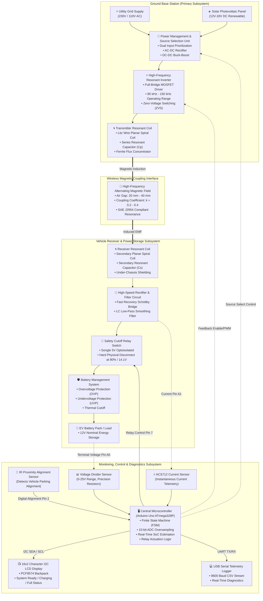
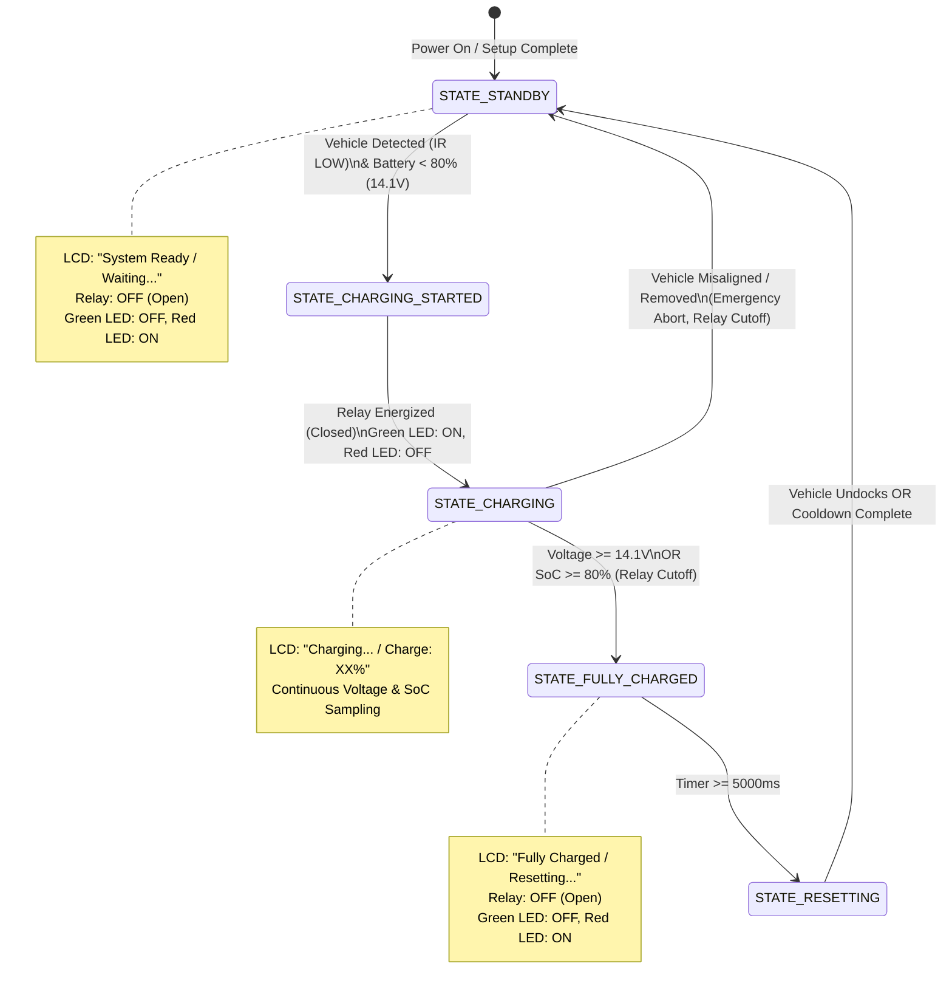

# System Architecture Specification

This document provides a comprehensive architectural specification for the **E-Charger: Resonant Wireless EV Charging Prototype**, detailing the power flow, magnetic coupling, control loops, and subsystem interfaces.

---

## 🏛 High-Level System Architecture

The system is organized into four interconnected domains:
1. **Primary Power Generation & Conversion Domain (Ground Station)**
2. **Resonant Magnetic Air-Gap Coupling Interface**
3. **Secondary Power Harvesting & Storage Domain (Vehicle Station)**
4. **Closed-Loop Monitoring, Protection & Telemetry Domain**

---

## 📊 End-to-End Architectural Diagram

---

## 🔁 Finite State Machine (FSM) State Architecture

The microcontroller executes a non-blocking 5-state finite state machine that governs the charging lifecycle and ensures battery safety.

---

## 🧩 Detailed Subsystem Breakdown

### 1. Primary Transmitter Subsystem
- **Dual Source Ingestion:** Accommodates high-reliability AC utility grid supply alongside clean renewable Solar PV power.
- **Power Management Unit (PMU):** Implements dynamic source selection prioritizing solar energy whenever solar irradiance exceeds the minimal operational threshold ($P_{solar} \ge P_{threshold}$); otherwise, seamlessly blends or switches to grid AC power.
- **High-Frequency Inverter:** High-speed MOSFET H-bridge switching at resonant frequency $f_0 \approx 100\text{ kHz}$. Zero-Voltage Switching (ZVS) minimizes turn-on switching losses.
- **Primary Resonant Tank:** Consists of transmitter inductance $L_p$ and series resonant compensation capacitor $C_p$, establishing resonant frequency:
  $$f_0 = \frac{1}{2\pi \sqrt{L_p C_p}}$$

### 2. Resonant Inductive Air-Gap Channel
- Energy is transferred solely through magnetic near-field flux lines without galvanic connection.
- Ferrite plates behind the coils shape the field geometry, reducing stray electromagnetic interference (EMI) and boosting magnetic coupling factor $k$ ($0.2 \le k \le 0.4$ across a $20\text{ mm} - 40\text{ mm}$ air gap).

### 3. Secondary Vehicle Pick-Up Subsystem
- **Receiver Resonant Coil:** Matches resonant tank frequency:
  $$f_s = \frac{1}{2\pi \sqrt{L_s C_s}} \approx f_0$$
- **Fast-Recovery Rectification:** High-speed Schottky diode bridge converts the $100\text{ kHz}$ alternating voltage into pulsating DC.
- **LC Low-Pass Filter:** Suppresses high-frequency harmonics, generating clean DC for charging.
- **Safety Cutoff Relay:** Physically disconnects the battery from the charging circuit upon reaching the 80% (14.1V) cutoff threshold to prevent overcharge stress.

### 4. Monitoring & Telemetry Subsystem
- **Arduino Uno ATmega328P:** Samples battery voltage every $1000\text{ ms}$ using a 10-sample rolling average to filter noise.
- **I2C 16x2 LCD:** Updates vehicle operator with real-time status:
  - `System Ready / Waiting...`
  - `Charging... / Charge: XX%`
  - `Fully Charged / Resetting...`
- **UART Serial Diagnostics:** Outputs CSV data stream at $9600\text{ baud}$ for external datalogging and verification.
